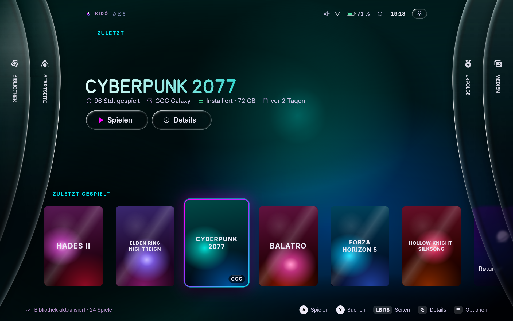
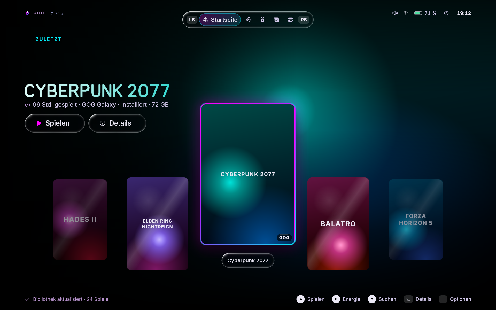
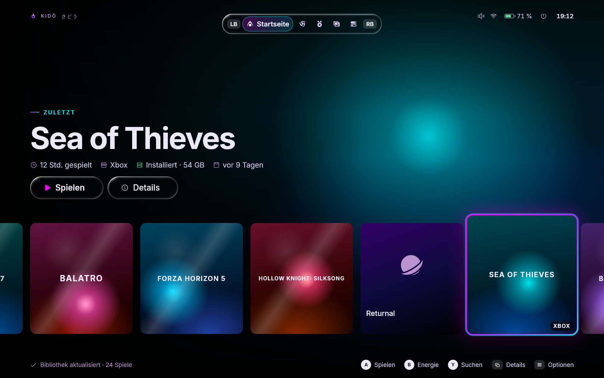
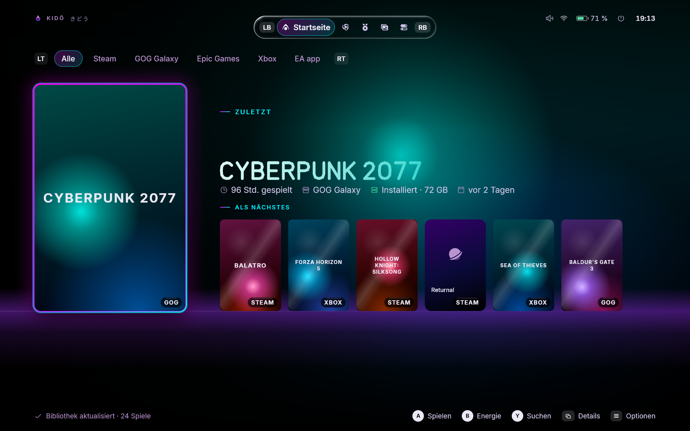
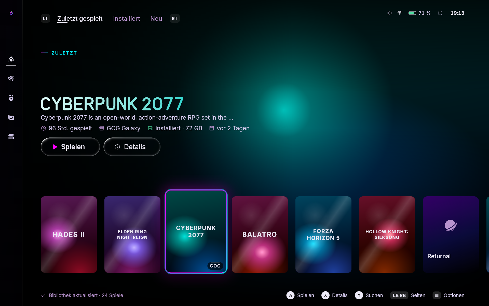

<h1 align="center">Kidō Plugins</h1>

  Stores, Home layouts and more for <b>Kidō</b> (releasing soon), 
  the controller-first home app that turns a Windows handheld into a console.

  

A plugin adds one thing to Kidō: a store, a Home layout, a look, or support for a device.
Kidō decides when a plugin runs and keeps the focus and the gamepad, and no plugin can slow Home's start.
A plugin with code runs in a sandbox and reaches only what its manifest asks for, and you see that before the install.

## Official Plugins

[`index.toml`](index.toml) is Kidō's list of official plugins; Kidō reads it when you open "Add plugins".

### Home Layouts

A Home layout draws Kidō's first page, Startseite.
The pack **Alle Startseiten** installs all five at once.

<table>
  <tr>
    <td width="50%">
       
      <b>Mondlicht</b> · <a href="layouts/moonlight">source</a> 
      The selected game's large cover in the middle of a still carousel.
    </td>
    <td width="50%">
       
      <b>Traumbild</b> · <a href="layouts/dreamscape">source</a> 
      A row of large square covers under the game's art.
    </td>
  </tr>
  <tr>
    <td>
       
      <b>Prozession</b> · <a href="layouts/procession">source</a> 
      The selected game's cover large on a lit stage, with store tabs.
    </td>
    <td>
       
      <b>Schattenspiel</b> · <a href="layouts/shadowplay">source</a> 
      The art framed by page lanes at both edges.
    </td>
  </tr>
  <tr>
    <td>
       
      <b>Schrein</b> · <a href="layouts/shrine">source</a> 
      The pages in a rail at the left, with group tabs.
    </td>
    <td></td>
  </tr>
</table>

The pictures show Kidō's test library, with painted covers in place of real art.

### Stores

| Plugin | What it adds |
| --- | --- |
| **GOG Galaxy** | Your GOG games, read from GOG Galaxy. |

The GOG Galaxy plugin is built from Kidō's own store code, so this repository holds its package and not its source.

## Install a Plugin

1. In Kidō, open Settings › Stores › Plugins and choose "Add plugins".
2. Choose a plugin or a pack, check what it may do, and confirm.
3. Restart Kidō when it offers to.

A Home layout is then under Settings › Appearance › Home layout.

Kidō hasn't checked a plugin that isn't on its list.
To install one, turn on external plugins under Settings › Stores.
Then press Y on the Plugins page and choose the `.kidouplug` file or the plugin's folder.

Kidō refuses a listed package whose SHA-256 differs from the one in `index.toml`.

## Write a Plugin

- [Plugin categories](docs/categories.md): what each category may do, and the manifest `plugin.toml`.
- [Write a Home layout](docs/layouts.md): the layout contract, what Kidō refuses, and how to pack and try a layout.
- [Contributing](CONTRIBUTING.md): how to change a plugin here, and what CI checks.

## License

[GPL-3.0-only](LICENSE).
A plugin you build from one of these stays open under it too.
