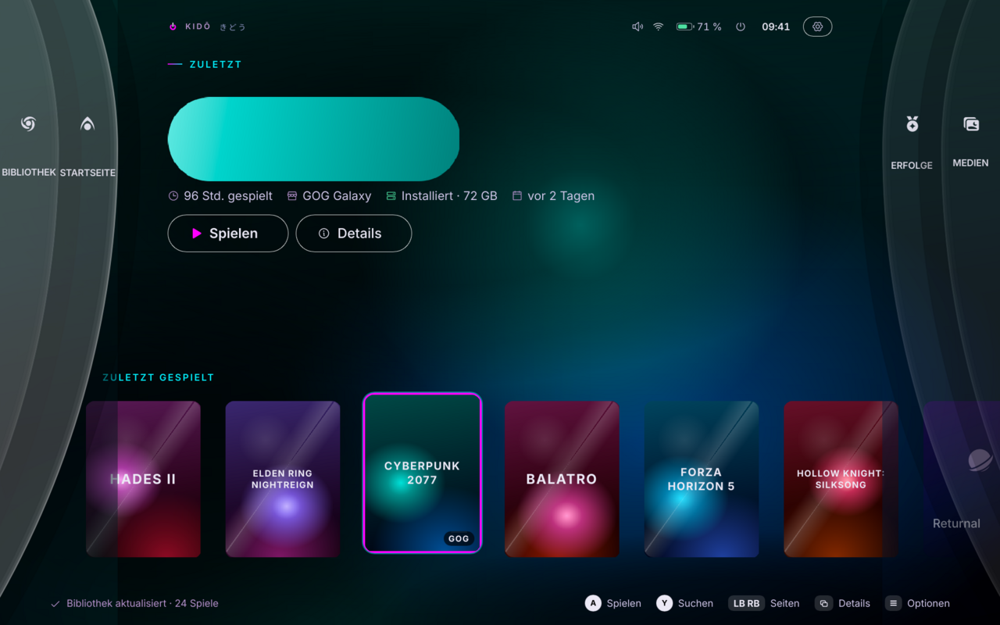
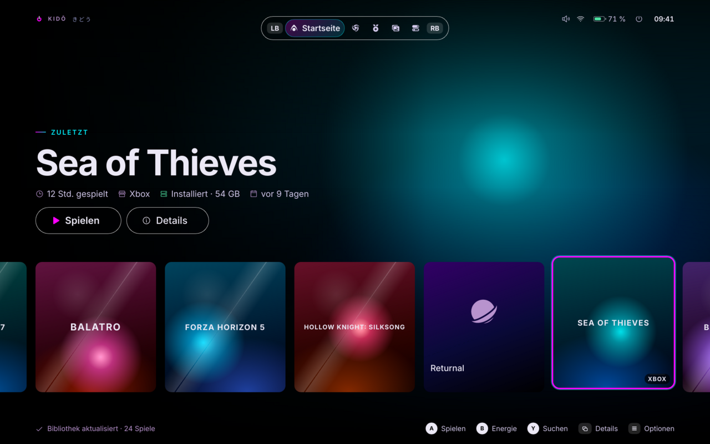
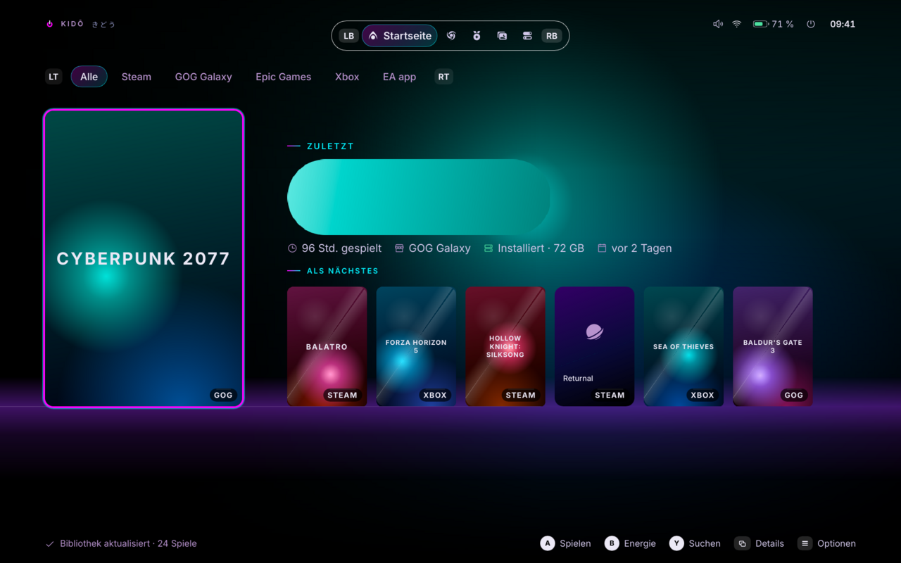
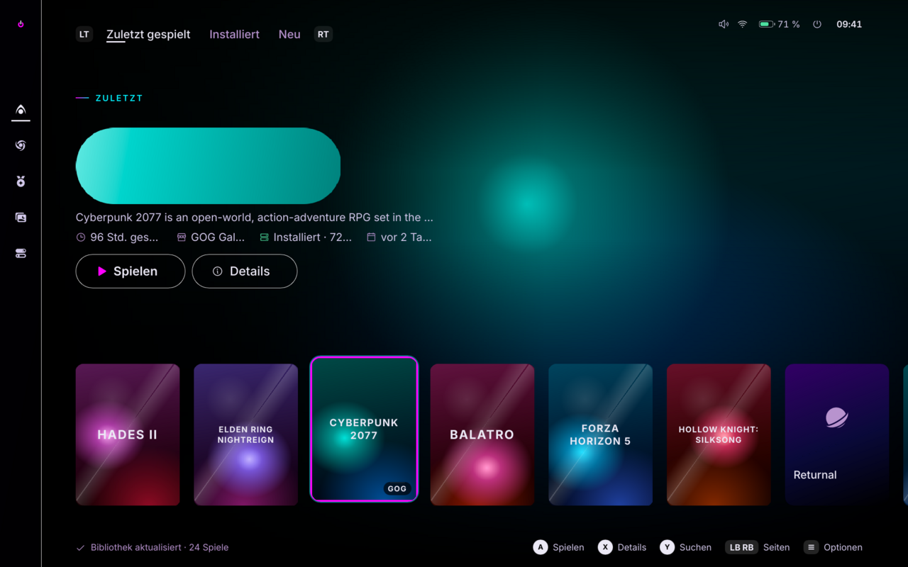

<h1 align="center">Kidō Plugins</h1>

<p align="center">
  Stores, Home layouts and more for <b>Kidō</b>,<br>
  the controller-first home app that turns a Windows handheld into a console.
</p>

<p align="center">
  <a href="#official-plugins">Official plugins</a> ·
  <a href="#install-a-plugin">Install</a> ·
  <a href="#categories">Categories</a> ·
  <a href="#write-a-home-layout">Write a layout</a> ·
  <a href="#how-this-repository-works">How this repository works</a>
</p>

<p align="center">
  
</p>

## What a Plugin Is

A plugin adds one thing to Kidō: a store, a Home layout, a look, support for a device.
It's a small folder with a manifest, `plugin.toml`, and what its category needs beside it.
Kidō installs it from a package, a `.kidouplug` file.

Three rules hold for every plugin:

- **One category.** A plugin is in exactly one category, and each category has its own interface and rules. A plugin that wants two things ships as two plugins.
- **Kidō stays in charge.** Kidō decides when a plugin runs, keeps the focus and the gamepad, and draws everything but a layout itself. No plugin can slow Home's start.
- **Nothing hidden.** A plugin with code runs in a sandbox and reaches only what its manifest asks for. You see what a plugin may reach before the install.

## Official Plugins

This repository is Kidō's list of official plugins: [`index.toml`](index.toml) names each one, and Kidō reads it when you open "Add plugins".

### Home Layouts

A Home layout draws Kidō's first page, Startseite.
The pack **Alle Startseiten** installs all five at once.

<table>
  <tr>
    <td width="50%">
      <br>
      <b>Mondlicht</b> · <a href="layouts/moonlight">source</a><br>
      The selected game's large cover in the middle of a still carousel.
    </td>
    <td width="50%">
      <br>
      <b>Traumbild</b> · <a href="layouts/dreamscape">source</a><br>
      A row of large square covers under the game's art.
    </td>
  </tr>
  <tr>
    <td>
      <br>
      <b>Prozession</b> · <a href="layouts/procession">source</a><br>
      The selected game's cover large on a lit stage, with store tabs.
    </td>
    <td>
      <br>
      <b>Schattenspiel</b> · <a href="layouts/shadowplay">source</a><br>
      The art framed by page lanes at both edges.
    </td>
  </tr>
  <tr>
    <td>
      <br>
      <b>Schrein</b> · <a href="layouts/shrine">source</a><br>
      The pages in a rail at the left, with group tabs.
    </td>
    <td></td>
  </tr>
</table>

The pictures show Kidō's test library, with painted covers in place of real art.

### Stores

| Plugin | What it adds |
| --- | --- |
| **GOG Galaxy** | Your GOG games, read from GOG Galaxy. |

The GOG Galaxy plugin is built from Kidō's own store code, so this repository holds its package and not its source.

## Install a Plugin

**An official plugin**

1. In Kidō, open Settings › Stores › Plugins and choose "Add plugins".
2. Choose a plugin or a pack. Kidō shows what it may do; confirm the install.
3. Restart Kidō when it offers to.

A Home layout is then under Settings › Appearance › Home layout.

**A plugin from elsewhere**

Kidō has not checked a plugin that isn't on its list, so this path is off until you turn it on.

1. Turn on external plugins under Settings › Stores.
2. On the Plugins page, press Y and choose the `.kidouplug` file or the plugin's folder.

Kidō refuses a listed package whose SHA-256 differs from the one in `index.toml`.

## Categories

| Category | Adds | Built with | May ask for | Runs |
| --- | --- | --- | --- | --- |
| `store` | A store's or launcher's games, their launches and links | WebAssembly, `kidou:store` 2.x | Registry keys, folders, link schemes, art hosts | At start; dropped where its store isn't found |
| `source` | Art and facts for any game | WebAssembly, `kidou:source` 1.x | Art hosts, `https` hosts it asks itself | At its first call |
| `device` | Support for a device and its maker's app: settings rows and quick-menu tiles | WebAssembly, `kidou:device` 1.x | Registry keys, folders, link schemes | Only on a device it serves |
| `events` | Acts when a game starts or ends; settings rows and quick-menu tiles | WebAssembly, `kidou:events` 1.x | Registry keys, folders, link schemes | At the events it names |
| `layout` | A Home layout | Slint, the layout contract 3.x | Nothing | Only while chosen |
| `look` | A look: colours and lights | A look file, schema 1.x | Nothing | Only while chosen |

Rules every category keeps:

- No plugin draws its own window but a `layout`. A plugin gives data, and Kidō draws it with its own focus and gamepad rules.
- A `device` plugin reads its maker's software and opens it. It writes nothing.
- Only a `source` plugin asks hosts over the network, and only the `https` hosts it names.
- A grant can carry a reason for the player, in English and German, each at most 80 characters. A plugin on Kidō's list needs a clear one.

The interfaces of the WebAssembly categories are in [`wit/`](wit).
[`devices/onexconsole`](devices/onexconsole) is a device plugin built on them: it shows OneXConsole's presets on a OneXPlayer and opens OneXConsole.
It isn't on Kidō's list yet.

### The Manifest

Every `plugin.toml` starts the same way:

```toml
id = "moonlight"         # the plugin's folder and package carry this name
name = "Mondlicht"
badge = "MOON"
version = "1.1.0"
author = "Kidō"
category = "layout"      # exactly one
api = "3.0.0"            # the version of the category's interface it's built for
```

A plugin built for `api = "3.0.0"` runs on every Kidō whose interface for that category is 3.0.0 or a later 3.x.
Kidō refuses a plugin built for another first number or for a later version than its own, a manifest with a key its category doesn't have, and a grant its category may not ask for.
The refusal names the rule.

## Write a Home Layout

A layout is Slint code in the folder `layout` beside the manifest.
It needs no build step:

```
my-layout/
├── plugin.toml
└── layout/
    ├── layout.slint      the layout, which exports the component `Layout`
    └── …                 its own .slint files and images
```

The five layouts in [`layouts/`](layouts) are the reference; start from the one closest to what you want.
The contract's own files are in [`crates/layout/contract/`](crates/layout/contract); this section sums them up.

### What Kidō Does, and What the Layout Does

Kidō keeps the focus and the keys.
It tells the layout which game is focused and in which zone, and the layout draws that.
The manifest picks the navigation Kidō gives the layout, from Kidō's own set:

```toml
[layout]
actions = "above"     # above | none: the selected game's actions, above the row
tabs = "none"         # none | stores | groups: tabs over the row, stepped with LT and RT
frame = "switcher"    # switcher | lanes | rail: how the pages show, which Kidō draws
art = "cover"         # cover | square: the art each game of the row comes with
scroll = "stage"      # stage | row: Kidō slides the row, or the layout scrolls it
```

`Layout` gets these from Kidō:

| Property | Holds |
| --- | --- |
| `tiles`, `focused`, `zone` | The row's games, the focused one, and where the focus is |
| `stage`, `hero` | The focused game's cover, and its title, tagline and facts |
| `tabs`, `tab` | The tabs' names in the player's language, and the chosen one |
| `empty`, `empty-words` | Whether the library has no game yet, and the words for that card |
| `theme` | The look's colours, the text scale, the card size and the edges to keep content between |

It gives these back:

| Property or callback | Says |
| --- | --- |
| `actions-x`, `actions-y` | Where Kidō draws the selected game's actions |
| `focused-place` | Where the focused game stands, for the launch animation |
| `activated(int)`, `tab-tapped(int)` | A tap on a game or on a tab |

Ready parts come with the contract, among them `Cover`, `RowCover`, `HeroTitle`, `Kicker`, `Facts`, `EmptyCard`, `Shoulder`, `Glass` and `Ring`.
`Kicker` and `Shoulder` came with contract 3.1.0: a layout that uses them says `api = "3.1.0"`.

### Reduced Motion

A player can turn motion down in Kidō's settings, and a layout must keep to that.
While `theme.reduced-motion` is true, a layout starts no animation: what would move changes at once.

Give the value its own animated property, and read that property only in full motion:

```slint
property <length> lifted: self.focused ? self.theme.focus-lift-cover : 0;
property <length> lift: self.theme.reduced-motion ? 0 : self.lifted;
animate lifted { duration: 130ms; easing: ease-out; }
y: self.rest-y + self.lift;
```

A test on `reduced-motion` inside the animated value isn't enough.
Slint still starts the animation when the focus moves, from 0 to 0, with nothing to see on screen.
Kidō's check can't find this, so look for it yourself in each `animate`.
The contract's parts, such as `RowCover` and `Ring`, keep the rule on their own.

### What Kidō Refuses

Kidō checks a layout before it installs it, and again after each update of Kidō.
A layout that breaks a rule isn't installed, and the refusal names each rule.
The main ones:

- No `FocusScope`, `TextInput`, `PopupWindow`, `Dialog`, `Timer`, menu or gesture-handler element, and no `changed` handler.
- It calls only `activated` and `tab-tapped`, and only in a `TouchArea`'s `clicked`.
- Each animation ends: at most 3 seconds and 10 iterations, both written as numbers. No call that isn't pure, such as `animation-tick()`.
- No `for` over a number and no `for` inside a `for`.
- Images are PNG, JPEG or SVG files of the layout, at most 4096 px a side, given to properties and never inside a `for`. No fonts: a layout uses Kidō's.
- At most 256 files, 8 MiB each and 32 MiB together, with names of `A-Z a-z 0-9 . _ -`.

### Pack and Try It

`kidouplug.exe` comes with Kidō.

```
kidouplug install my-layout                     install the folder as it is
kidouplug install my-layout --replace           install over the last try
kidouplug pack my-layout my-layout-1.0.0.kidouplug
```

`pack` writes the package and shows its SHA-256.
The same folder always gives the same file.

## How This Repository Works

```
index.toml       Kidō's list: each plugin's id, name, category, version, api, package and SHA-256
layouts/<id>/    the source of each Home layout
devices/<id>/    the source of each device plugin
wit/             the interfaces of the WebAssembly categories
packages/        every listed package; a file here never changes
xtask/           the check and the packer that CI runs
```

To change a plugin:

1. Change its source under `layouts/<id>/` or `devices/<id>/`.
2. Raise `version` in its `plugin.toml`. Leave `index.toml` and `packages/` alone.
3. Open a pull request.

CI checks that the list, the packages and the sources fit each other, and that the source packs.
For a plugin with code it first builds the component, `plugin.wasm`, for `wasm32-wasip2`.
The compiler, the dependencies and the release profile are fixed here, so the same source gives the same package.
A new compiler or dependency can change the component, and CI then asks for a new version of the plugin.
A component holds the paths of its source files as the build's system writes them, so compare a listed plugin with code on Linux, as CI does.
It also runs the check Kidō runs on a Home layout at the install, from [`crates/layout/`](crates/layout), which is the code Kidō itself builds.
An SVG gets the time Kidō gives it there: 10 seconds, and 60 seconds for all of a layout's SVGs.
Kidō's check of the manifest isn't part of it, nor the memory limit Kidō sets for drawing an SVG on Windows, so install a new plugin with `kidouplug` once before you open the pull request.
After the merge it packs the new version, adds the file to `packages/` and updates the plugin's entry in `index.toml`.
Players get it the next time they open "Add plugins".

A new plugin also needs its `[[plugin]]` entry in `index.toml`, with its `id`, `name`, `category` and `about` only: CI adds `version`, `api`, `package` and `sha256`.
Kidō offers a listed plugin only where it runs the plugin's `api`.
Until it has that entry, CI checks and builds the source, and writes no package.

Run the same check yourself with a Rust toolchain. It builds Slint's compiler, which on Linux needs fontconfig's development files (`libfontconfig-dev`):

```
cargo xtask check
```

## License

[GPL-3.0-only](LICENSE), the same license as Kidō.
A plugin you build from one of these stays open under it too.
